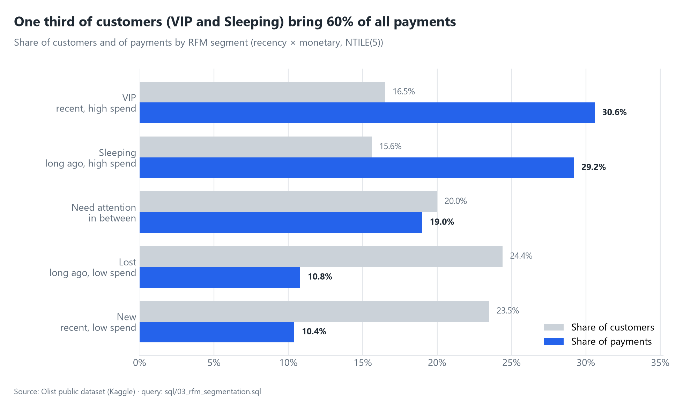

# SQL Analytics Cases: Olist E-Commerce

> Six business questions answered with PostgreSQL on ~100k real e-commerce orders: revenue dynamics, retention, RFM, delivery quality, assortment and sellers.

## Business context

Olist is a Brazilian platform that helps small merchants sell on large online marketplaces. The public dataset covers ~100k orders from 2016 to 2018, with payments, deliveries, reviews, products and sellers.

I analyze it the way I would for a commercial team: every case starts with a business question and ends with a recommendation.

## Cases

| # | Business question | Techniques | Query | Status |
| --- | --- | --- | --- | --- |
| 1 | How did revenue, orders and average order value develop month by month? | CTE, `date_trunc`, `LAG` | [01](sql/01_revenue_dynamics.sql) | done |
| 2 | Do customers come back after their first purchase? | Cohorts, retention matrix, `generate_series` | [02](sql/02_cohort_retention.sql) | done |
| 3 | Which customer segments generate the revenue? | RFM (recency × monetary), `NTILE` | [03](sql/03_rfm_segmentation.sql) | done |
| 4 | How much does a late delivery hurt the review score? | Joins, conditional aggregation | [04](sql/04_delivery_vs_reviews.sql) | to do |
| 5 | Which categories form the revenue core, and which are unstable? | ABC/XYZ, cumulative share, coefficient of variation | [05](sql/05_abc_xyz_categories.sql) | to do |
| 6 | Do 20% of sellers make 80% of the revenue? | Window functions, Pareto | [06](sql/06_seller_pareto.sql) | to do |

## Results

### 1. Revenue dynamics


**Insight:** Monthly revenue grew 8× in a year, from BRL 112K in January 2017 to BRL 925K in January 2018, and then plateaued at about BRL 0.9M; in June–August 2018 it was 12% below March–May. The growth came from more orders, not bigger baskets: the average order value stayed between BRL 124 and BRL 149. The record month was November 2017 (+52% month over month), with a single-day peak on Black Friday (24 November): 1,147 orders, more than six times a typical November day.

**Recommendation:** Order volume stopped growing in 2018 and the average order value never grew, so the next lever is basket size and repeat purchases: test bundles and a free-shipping threshold to lift the order value, and check in case 2 whether customers come back.

### 2. Cohort retention


**Insight:** 97% of customers bought only once (90,557 of 93,358). In no cohort did more than 0.72% of customers buy again in any later month; even in the oldest cohort (January 2017) only 20 of 717 customers (2.8%) came back within a year. Customers who returned in a later month brought just 1.8% of revenue, so the growth in case 1 came almost entirely from new customers.

**Recommendation:** Growth depends on new customers, and their number stopped growing in 2018 (case 1), so test a second-purchase incentive, such as a voucher sent with the delivery, as an A/B test against a control group, with month-1 retention as the success metric.

### 3. RFM segmentation



**Insight:** Frequency is useless here because 97% of customers bought once, so the segments use only recency and monetary (what the customer paid, freight included), with NTILE(5) for each. VIP and Sleeping customers are a third of the base (32%) but bring 60% of all payments. Their average payment is almost the same (BRL 307 vs BRL 310); they differ only in recency: about 3 months versus more than a year since the last order. New customers are the second-largest group (23.5%) but bring only 10% of payments.

**Recommendation:** Split the retention budget by segment: give VIP customers a second-purchase incentive right after delivery (the A/B test from case 2), run a win-back campaign for Sleeping customers, who are worth as much as VIP, and keep Lost customers on low-cost automated messages only.

## Data

Brazilian E-Commerce Public Dataset by Olist (Kaggle): 9 CSV files, ~100k orders, 2016–2018. The raw files are not stored in this repository, see [data/README.md](data/README.md).

## How to run

1. Install PostgreSQL and create a database called `olist`.
2. Download the dataset and put the CSV files into `data/raw/`.
3. Copy `.env.example` to `.env` and set `DATABASE_URL`.
4. Load the data:

```bash
python -m venv .venv
.venv\Scripts\activate          # Windows
python -m pip install -r requirements.txt
python scripts/load_olist.py
```

5. Run `sql/00_check_load.sql` to check the row counts, then the case queries.
6. Build the charts for this README:

```bash
python scripts/charts.py
```

## Project structure

```
sql-analytics-cases/
├── data/
│   └── README.md          # how to download the dataset
├── images/                # charts used in this README
├── notebooks/             # exploration
├── scripts/
│   ├── charts.py          # builds the README charts from the case queries
│   └── load_olist.py      # loads the CSV files into PostgreSQL
├── sql/
│   ├── 00_check_load.sql
│   └── 01–06_*.sql        # one file per business case
├── .env.example
├── requirements.txt
└── README.md
```

Status: case 3 of 6 done, cases 4–6 by December 2026

## Author

Illia Sukhikh · Data Analyst · [LinkedIn](https://www.linkedin.com/in/illia-sukhikh) · illia.sukhikh.data@gmail.com
