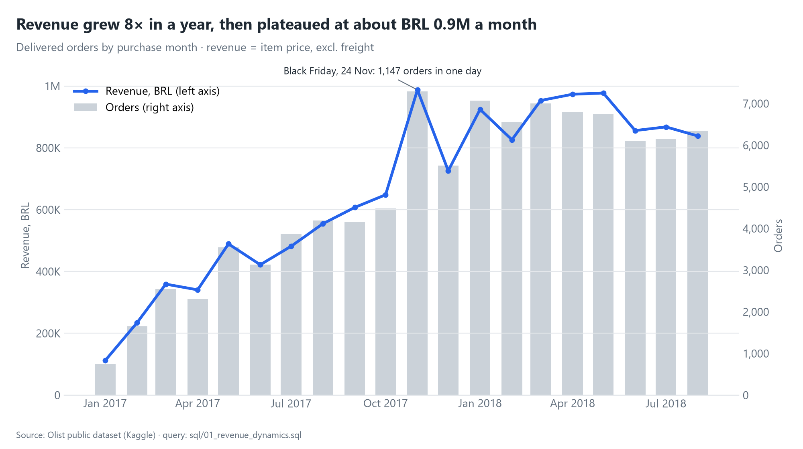
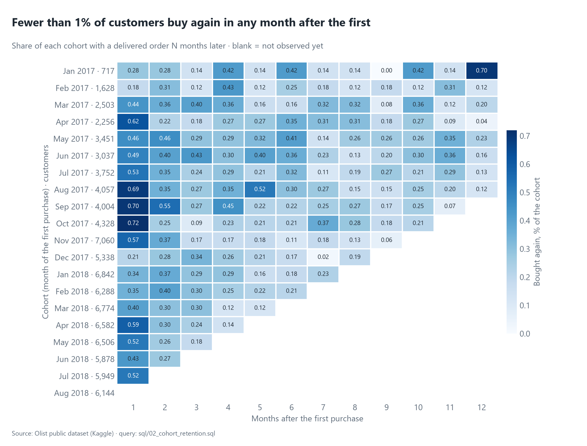
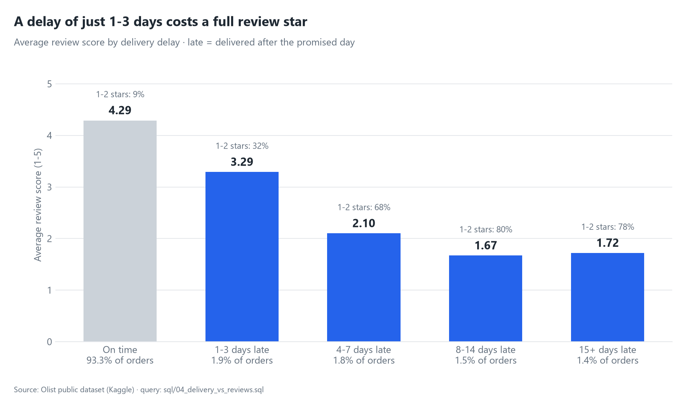
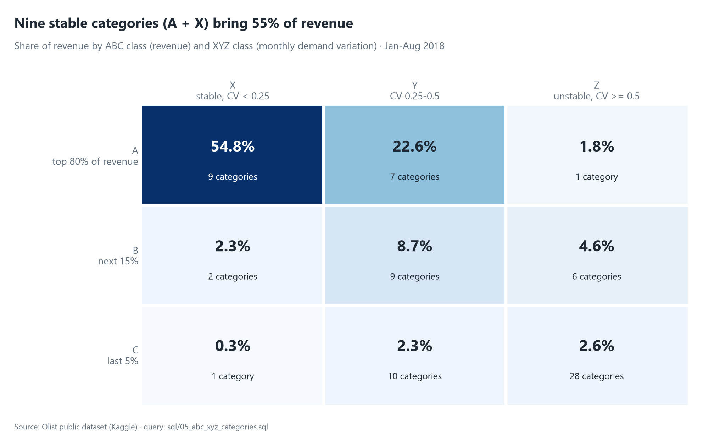
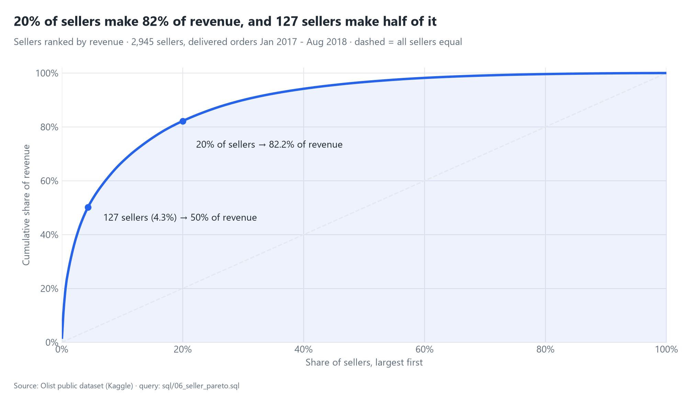

# SQL Analytics Cases: Olist E-Commerce

> Six business questions answered with PostgreSQL on ~100k real e-commerce orders: revenue dynamics, retention, RFM, delivery quality, assortment and sellers.

## Key findings

1. **Growth has stalled.** Monthly revenue grew 8× in a year and then plateaued at about BRL 0.9M in 2018 (case 1).
2. **Customers do not come back.** 97% of customers bought only once, so growth came almost entirely from new customers (case 2).
3. **A third of customers bring 60% of payments.** VIP and Sleeping customers spend about the same; they differ only in how long ago they bought (case 3).
4. **Late deliveries ruin reviews.** Even a 1–3 day delay costs a full star; late orders are 7% of deliveries but a third of all 1–2 star reviews (case 4).
5. **Nine stable categories bring 55% of revenue**, while 28 small categories with unstable demand bring 2.6% (case 5).
6. **20% of sellers make 82% of revenue**, and 127 sellers make half of it; the risk is their shipping quality, not dependence on one seller (case 6).

## Business context

Olist is a Brazilian platform that helps small merchants sell on large online marketplaces. The public dataset covers ~100k orders from 2016 to 2018, with payments, deliveries, reviews, products and sellers.

I analyze it the way I would for a commercial team: every case starts with a business question and ends with a recommendation.

## Cases

| # | Business question | Techniques | Query | Status |
| --- | --- | --- | --- | --- |
| 1 | How did revenue, orders and average order value develop month by month? | CTE, `date_trunc`, `LAG` | [01](sql/01_revenue_dynamics.sql) | done |
| 2 | Do customers come back after their first purchase? | Cohorts, retention matrix, `generate_series` | [02](sql/02_cohort_retention.sql) | done |
| 3 | Which customer segments generate the revenue? | RFM (recency × monetary), `NTILE` | [03](sql/03_rfm_segmentation.sql) | done |
| 4 | How much does a late delivery hurt the review score? | Joins, conditional aggregation, `ROW_NUMBER` | [04](sql/04_delivery_vs_reviews.sql) | done |
| 5 | Which categories form the revenue core, and which are unstable? | ABC/XYZ, cumulative share, coefficient of variation, `generate_series` | [05](sql/05_abc_xyz_categories.sql) | done |
| 6 | Do 20% of sellers make 80% of the revenue? | Window functions, Pareto | [06](sql/06_seller_pareto.sql) | done |

## Results

### 1. Revenue dynamics



**Insight:** Monthly revenue grew 8× in a year, from BRL 112K in January 2017 to BRL 925K in January 2018, and then plateaued at about BRL 0.9M; in June–August 2018 it was 12% below March–May. The growth came from more orders, not bigger baskets: the average order value stayed between BRL 124 and BRL 149. The record month was November 2017 (+52% month over month), with a single-day peak on Black Friday (24 November): 1,147 orders, more than six times a typical November day.

**Recommendation:** Order volume stopped growing in 2018 and the average order value never grew, so the next lever is basket size and repeat purchases: test bundles and a free-shipping threshold to lift the order value, and check in case 2 whether customers come back.

### 2. Cohort retention



**Insight:** 97% of customers bought only once (90,557 of 93,358). In no cohort did more than 0.72% of customers buy again in any later month; even in the oldest cohort (January 2017) only 20 of 717 customers (2.8%) came back within a year. Customers who returned in a later month brought just 1.8% of revenue, so the growth in case 1 came almost entirely from new customers.

**Recommendation:** Growth depends on new customers, and their number stopped growing in 2018 (case 1), so test a second-purchase incentive, such as a voucher sent with the delivery, as an A/B test against a control group, with month-1 retention as the success metric.

### 3. RFM segmentation


**Insight:** Frequency is useless here because 97% of customers bought once, so the segments use only recency and monetary (what the customer paid, freight included), with NTILE(5) for each. VIP and Sleeping customers are a third of the base (32%) but bring 60% of all payments. Their average payment is almost the same (BRL 307 vs BRL 310); they differ only in recency: about 3 months versus more than a year since the last order. New customers are the second-largest group (23.5%) but bring only 10% of payments.

**Recommendation:** Split the retention budget by segment: give VIP customers a second-purchase incentive right after delivery (the A/B test from case 2), run a win-back campaign for Sleeping customers, who are worth as much as VIP, and keep Lost customers on low-cost automated messages only.

### 4. Delivery quality vs. review score



**Insight:** 93% of orders arrive on time and score 4.29 on average. A delay of just 1–3 days drops the score to 3.29, and after a week about 80% of reviews are 1–2 stars. Late orders are only 7% of deliveries but cause a third (33%) of all 1–2 star reviews. The problem is regional: 21% of orders arrive late in Alagoas and 17% in Maranhão, and 12% in Rio de Janeiro, the second-largest market, against 4% in São Paulo ([by state](sql/04b_delivery_by_state.sql)).

**Recommendation:** Treat on-time delivery as a review-score lever: set more realistic delivery promises (or change carriers) for the Northeast and Rio de Janeiro, notify customers before an order runs late, and track the late-order rate by state next to the review score.

### 5. ABC/XYZ analysis of product categories



**Insight:** Both classes use January–August 2018, the plateau after the 2017 growth: over the full period 60 of 74 categories would look unstable (Z) only because the business grew 8×. Nine large and stable categories (A + X: health & beauty, watches & gifts, bed & bath, sports & leisure, housewares, furniture & decor, auto, perfumery, toys) bring 55% of revenue. At the other end, 28 small categories with unstable demand (C + Z) bring only 2.6%. Thresholds: A = top 80% of revenue, B = next 15%; X: CV < 0.25, Y: 0.25–0.5, Z: 0.5 and above.

**Recommendation:** Focus seller acquisition, promotions and availability checks on the nine A + X categories, where demand is large and predictable; give the 28 C + Z categories no dedicated budget and review them once a year.

### 6. Seller Pareto



**Insight:** The 80/20 rule holds: 20% of 2,945 sellers make 82% of revenue, and just 127 sellers (4.3%) make half of it. Dependence on any single seller is low: the largest makes 1.7% of revenue and the top 10 together 13%. The risk is shipping quality and geography: two of the top 10 ship late far more often than average (31% and 17% of items vs. 9% overall), and 9 of the top 10 are in São Paulo ([top 10](sql/06b_top_sellers.sql)).

**Recommendation:** Run a key-account program for the ~130 sellers that make half of revenue, with a shipping-time SLA reviewed monthly, starting with the two top-10 sellers that ship late, because late shipping can turn into the late deliveries that drive bad reviews (case 4).

## Data

Brazilian E-Commerce Public Dataset by Olist (Kaggle): 9 CSV files, ~100k orders, 2016–2018. The raw files are not stored in this repository, see [data/README.md](data/README.md).

## How to run

1. Install PostgreSQL and create a database called `olist`.
2. Download the dataset and put the CSV files into `data/raw/`.
3. Copy `.env.example` to `.env` and set `DATABASE_URL`.
4. Load the data:

```bash
python -m venv .venv
.venv\Scripts\activate          # Windows
python -m pip install -r requirements.txt
python scripts/load_olist.py
```

5. Run `sql/00_check_load.sql` to check the row counts, then the case queries.
6. Build the charts for this README:

```bash
python scripts/charts.py
```

## Project structure

```
sql-analytics-cases/
├── data/
│   └── README.md          # how to download the dataset
├── images/                # charts used in this README
├── notebooks/             # exploration
├── scripts/
│   ├── charts.py          # builds the README charts from the case queries
│   └── load_olist.py      # loads the CSV files into PostgreSQL
├── sql/
│   ├── 00_check_load.sql
│   └── 01–06_*.sql        # one file per business case (+ 01b, 04b, 06b drill-downs)
├── .env.example
├── requirements.txt
└── README.md
```

Status: all six cases done (November 2026)

## Author

Illia Sukhikh · Data Analyst · [LinkedIn](https://www.linkedin.com/in/illia-sukhikh) · illia.sukhikh.data@gmail.com
